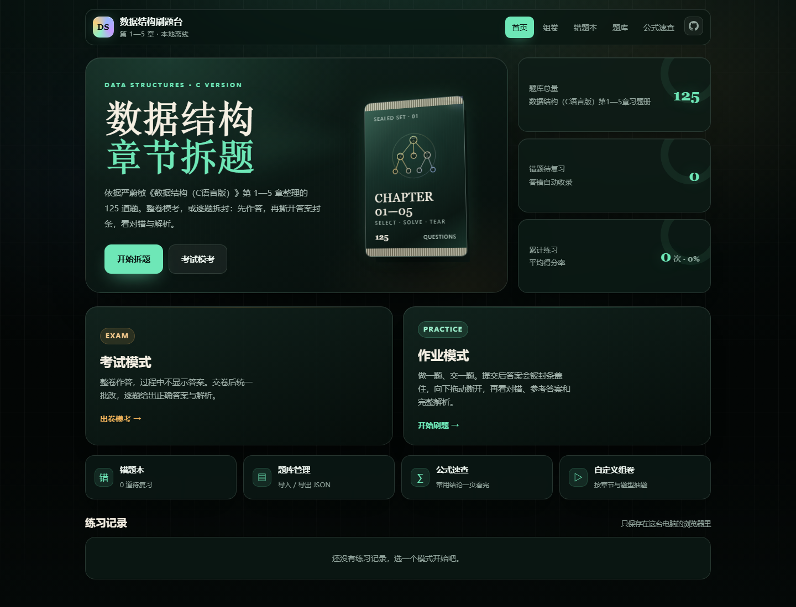
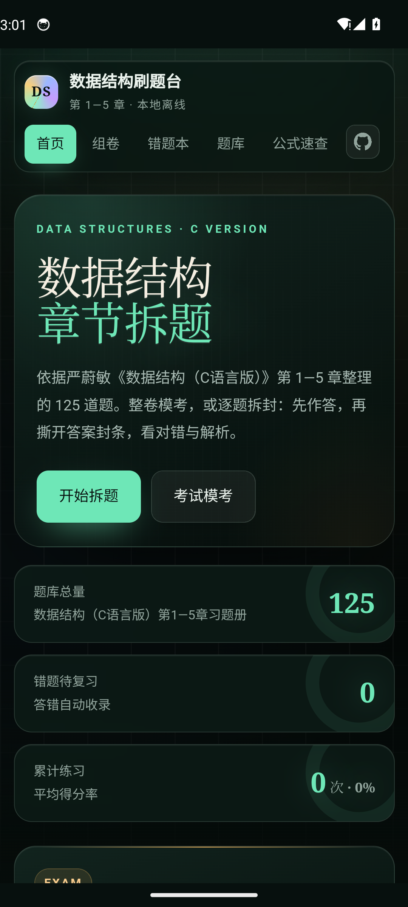
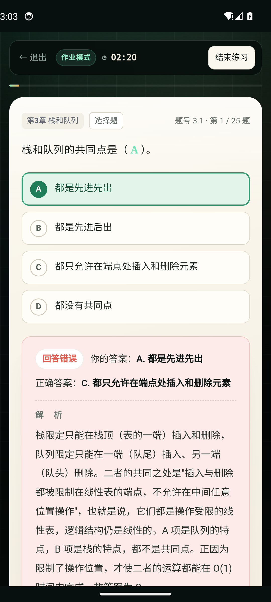

# 数据结构刷题系统


一个完全离线的数据结构刷题应用。Windows 桌面版用 Electron，安卓版用原生 WebView。题库来自《数据结构（C语言版）》第 1—5 章习题册，共 **125 道章节题**；另把课堂上拍的 **30 道随堂练习**整理成独立章节，合计 **155 题**，覆盖选择题、填空题、判断题、简答计算题和算法设计题。

界面采用“深色展台 + 浅色答题卡”的视觉：首页像一包封好的题卡，作业模式提交后，答案会被封条盖住，向下拖动撕开才揭晓。手机端首页右侧还有一张随堂练习悬浮卡片，点一下就能直接进入随堂练习组卷。设计参考了三条抖音“撕卡 / 盲盒抽卡”视频，详细拆解见 [docs/视觉参考拆解.md](docs/视觉参考拆解.md)。

> 如果这个项目对你有帮助，欢迎到 [GitHub 仓库](https://github.com/xiazhuo123456789/data-structure-quiz) 点个 Star。



## 功能

- **考试模式**：整卷作答，交卷前不显示答案和解析；可选不限时、60、90、120 分钟倒计时，时间到自动交卷；交卷时提示未答题，交卷后统一批改并逐题展示答案与解析。
- **作业模式**：每做一题、交一题。提交后答案会被封条盖住，向下拖动撕开，才显示对错、参考答案和完整解析；松手不过半会回弹。主观题按“完全掌握 / 部分掌握 / 未掌握”自评；不会时可以“直接看答案”。
- **组卷**：按章节、题型多选，题量 10 / 15 / 25 / 50 / 全部，可随机抽题或按题号顺序。“随堂练习”既是一个独立章节，也是“选择题型”里的一个独立筛选项。
- **刷题辅助**：题卡导航、进度条、计时、断点续答、错题本自动收录与重练、错题“算我对”纠错、结果页按错题/未答/主观题筛选。
- **历史记录回看**：每次完成的练习会保存题目、作答、正确答案和解析快照。首页点任意一条记录，就能以只读方式逐题回看。旧版本留下的摘要记录也能打开，但只能看成绩，不能还原题目。
- **题库管理**：导入导出 JSON 题库，导入文本题库，恢复内置题库。
- **公式速查**：内置常用公式与复杂度速查页。
- **完全离线**：无网络请求、无外部 CDN，题库直接内嵌在页面里。

## 下载与安装

### Windows 桌面版

到本仓库的 **Releases** 页面下载最新的 Windows 安装包，双击安装即可。安装完桌面和开始菜单都会出现“数据结构刷题系统”。本地构建的 `dist/数据结构刷题系统-Setup-1.2.0.exe` 也可以直接安装。

安装包只支持 64 位 Windows 10 / 11。安装时可以选择安装目录，默认安装到当前用户目录，不需要管理员权限。

安装包没有购买代码签名证书，Windows 可能提示“未知发布者”。点“更多信息”，再点“仍要运行”即可。

安装完成后，桌面和开始菜单都会有“数据结构刷题系统”的快捷方式。默认装在 `%LOCALAPPDATA%\Programs\data-structure-quiz`，安装时可以改。

### Android 手机版

下载最新的 Android APK，传到手机后点开安装。系统会提示“未知来源”或“外部来源应用”，按提示允许当前文件管理器安装即可。本地构建的 `dist/数据结构刷题系统-安卓-1.2.0.apk` 也可以直接安装。

安卓版支持 Android 8.0 及以上，包名是 `com.xiazhuo.datastructurequiz`，版本号 1.2.0。应用不申请网络权限，页面和 155 道题都打包在安装包内，断网也能正常刷题。

桌面版和安卓版的答题记录各自保存在本机，不互通。卸载安卓应用会清除本机的答题记录。






## 直接使用源码

不安装也可以。用 Chrome、Edge 或 Firefox 打开：

```text
app/index.html
```

这是单文件应用，题库已经内嵌，双击就能做题。不要用微信、QQ 的文件预览或手机文件管理器打开，那些工具只预览文档、不执行网页脚本，会一直停在加载动画。

## 从源码运行桌面版

需要 Node.js 18 以上。

```bash
npm install
npm start
```

## 重新生成 HTML

修改 `src/app.template.html` 或题库后，执行：

```bash
python tools/build_html.py
```

脚本会把 `src/题库_数据结构1-5章.json` 注入模板的 `/*__BANK__*/ null` 占位符，输出 `app/index.html`。

## 打包安装包

```bash
npm run dist
```

产物在 `dist/` 目录。也可以打便携版：

```bash
npm run dist:portable
```

如果下载 Electron 或 NSIS 工具时网络超时，先设置镜像再重试：

```powershell
$env:ELECTRON_MIRROR="https://npmmirror.com/mirrors/electron/"
$env:ELECTRON_BUILDER_BINARIES_MIRROR="https://npmmirror.com/mirrors/electron-builder-binaries/"
npm install
npm run dist
```

## 构建安卓版

需要 JDK 17、Android SDK Platform 35、Build-Tools 35.0.0 和 Gradle 8.9。

先复制离线页面，再编译：

```powershell
cd android
python tools/build_android.py
gradle assembleRelease
```

产物在：

```text
android/app/build/outputs/apk/release/app-release.apk
```

`android/local.properties` 要指向本机 SDK，例如：

```properties
sdk.dir=E:/Android/Sdk
```

发布签名读取 `android/keystore.properties`，这个文件和 `release-key.jks` 不进 Git。没有这两个文件时，Gradle 会生成未签名的 release 包，不能直接安装。详细步骤见 [android/README.md](android/README.md)。


## 题库格式

题库是 UTF-8 JSON，顶层字段：

| 字段 | 说明 |
| --- | --- |
| `meta` | 标题、来源、题量等元信息 |
| `chapters` | 章节列表 |
| `questions` | 题目数组 |
| `appendix` | 公式速查内容 |

题目主要字段：

| 字段 | 说明 |
| --- | --- |
| `uid` | 唯一 ID |
| `chapter` / `chapterTitle` | 章节号与章节名 |
| `type` / `typeTitle` | `choice` / `blank` / `judge` / `short` / `algo` |
| `no` | 题号，如 `2.13` |
| `stem` | 题干，代码块用 `[BLOCK:n]` 引用 |
| `options` | 选择题选项 |
| `answer` / `answerKey` / `answerParts` | 参考答案、判分键、分空答案 |
| `blanks` | 填空题空位数 |
| `auto` | 是否自动判分，false 表示人工自评 |
| `explanation` | 解析 |
| `blocks` | 代码块或表格，`{"type":"code","text":...}` / `{"type":"table","rows":[...]}` |

`tools/docx转题库.py` 可以把同样排版的 Word 习题册转成这个 JSON 格式。

## 数据保存

答题记录、错题本、历史成绩保存在本机，不上传。桌面安装版的数据目录是：

```text
%APPDATA%\数据结构刷题系统
```

安卓版的记录存在应用自己的 WebView 本地存储里，不需要存储权限。卸载应用会一并清除。卸载桌面版默认不删除数据目录，重新安装后记录还在。如果换电脑，可以在应用里导出题库，但答题记录不会自动迁移。


## 目录结构

```text
data-structure-quiz/
├─ app/index.html              # 可直接打开的成品（题库已内嵌）
├─ electron/main.js            # Electron 主进程：窗口、菜单、外链
├─ android/                    # 原生 WebView 安卓工程
│  ├─ app/src/main/assets/     # 打包进 APK 的 index.html
│  ├─ app/src/main/java/       # MainActivity
│  └─ tools/                   # 复制页面、生成安卓图标
├─ assets/                     # 桌面与安卓图标
├─ src/
│  ├─ app.template.html        # UI 模板，含题库占位符
│  └─ 题库_数据结构1-5章.json   # 结构化题库，155 题（含 30 道随堂练习）
├─ tools/
│  ├─ build_html.py            # 题库注入模板
│  ├─ docx转题库.py            # Word 习题册转 JSON
│  └─ make_icon.py             # 生成图标
├─ package.json
├─ LICENSE
└─ README.md
```

## 说明

- 代码以 MIT 协议开源。
- 题库内容整理自《数据结构（C语言版）》配套习题册，版权归原书作者与出版方。本项目只用于个人复习，请勿用于商业用途。
- 应用右上角的 GitHub 图标会打开作者主页；主窗口内的外部链接一律交给系统默认浏览器打开。

## 作者

[xiazhuo123456789](https://github.com/xiazhuo123456789)
